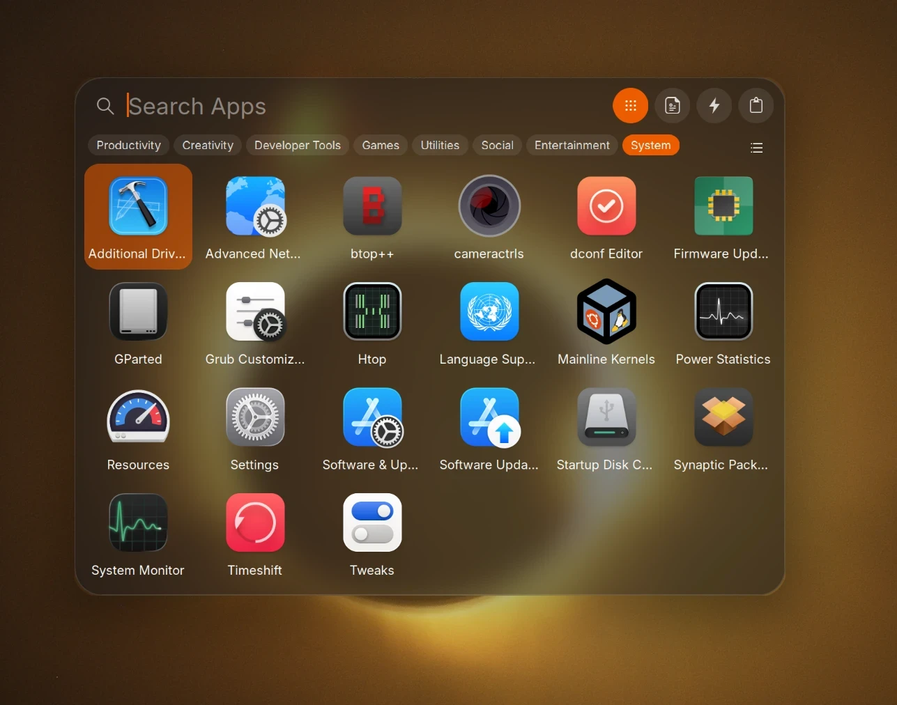

# Spotlight Search

A macOS-style search bar for GNOME Shell. Press ⌘Space (Super+Space) to find apps, files, settings and actions,
calculate, run quick actions and paste from your clipboard history.


<p align="center">
  
</p>

## Features

- **One search for everything:** apps, files, settings panels, GNOME search providers, actions, clipboard and web
- **Top Hit** first, results grouped in sections, inline completion, ranking by how often and how recently you open things
- **Filter chips** under the bar: Apps, Files, Settings, Folders and more
- **Calculator:** type `12*7+3`, Return copies the result
- **Files view:** recent files, search through the system index, type filters, folder scope, Quick Look with Space
- **Apps view:** A–Z grid or list with category chips; the Launchpad key (F4) opens it
- **Actions view:** lock, log out, suspend, restart, power off, screenshot, Wi-Fi, Bluetooth, Dark Mode,
  Do Not Disturb, Night Light, timer, new email, new note, empty trash, `.desktop` app actions and your own commands
- **Quick Keys:** short codes such as `tm` (timer) or `lk` (lock), editable in the preferences
- **Clipboard view:** opt-in history of text, links, images and file copies; Return pastes into the previous window
- **Glass look** that follows light and dark style, with a reduce-transparency option
- Leaves GNOME's Overview and its search unchanged

## Requirements

| | |
|---|---|
| GNOME Shell | 51, Wayland |
| Packages | `gnome-sushi` (Quick Look), `localsearch` (file index), `gir1.2-tsparql-3.0` (index query API) |
| Installer | Ubuntu or Debian (`apt`); on other distributions use the manual install |
| Tested on | Ubuntu 26.10, GNOME 51, MacBook Pro 11,5 |

## Installation

### With the installer

```bash
git clone https://github.com/AlexG-78/spotlight-search.git
cd spotlight-search
bash install.sh
```

The installer runs as your user and asks before it changes anything. It:

- installs the missing packages with `apt` (asks for your password)
- copies the extension to `~/.local/share/gnome-shell/extensions/mbp115-spotlight@alexg-78` and enables it
- binds ⌘Space to Spotlight and F4 to its Apps view, and removes these keys from GNOME's Overview and input-source switch
- turns off the third-party extension `spotlight@nin` if it is enabled
- saves your previous shortcuts in `~/.config/mbp115/spotlight.backup`

Log out and back in once, then press ⌘Space.

`bash install.sh status` exits with 0 when Spotlight is installed and set up.

### Manual

```bash
dest=~/.local/share/gnome-shell/extensions/mbp115-spotlight@alexg-78
mkdir -p "$dest" && cp -r extension/mbp115-spotlight@alexg-78/. "$dest/"
glib-compile-schemas "$dest/schemas"
```

Log out and back in, then run `gnome-extensions enable mbp115-spotlight@alexg-78`.
Install the packages from [Requirements](#requirements) with your package manager.
If Super+Space already switches input sources, change one of the two shortcuts.

### Update

```bash
git pull && bash install.sh
```

The installer copies the new files when the installed ones differ. Log out and back in afterwards.

### Uninstall

```bash
bash install.sh remove
```

Restores the saved shortcuts and removes the extension. The packages stay installed.

## Usage

| Key | Action |
|---|---|
| ⌘Space | Open or close Spotlight |
| F4 (Launchpad key) | Apps view |
| Ctrl+1 / 2 / 3 / 4 | Apps / Files / Actions / Clipboard (empty bar); with a query: filter chips |
| ↑ ↓ (← → in the grid) | Move the selection |
| Return | Open, run or paste |
| Shift+Return | Show the file in Files |
| Space | Quick Look on a file |
| Tab | Accept the completion, lock a folder as search scope, or move to the next action field |
| Esc | Clear the query, then close |
| Ctrl+Backspace | Forget the selected clipboard entry |

⌘ is the Super key on Apple keyboards. If your layout sends Ctrl for ⌘ (xkb option `altwin:ctrl_win` or
`ctrl:swap_lwin_lctl`), the installer binds Ctrl+Space instead.

Spotlight opens on the monitor under the pointer and closes on Esc, a click outside, focus loss or the Overview.
A magnifier in the top bar opens it too.

## Configuration

Open the preferences in Extension Manager (⚙) or with `gnome-extensions prefs mbp115-spotlight@alexg-78`.

| Page | Settings |
|---|---|
| General | shortcuts, style (follow system, light, dark), reduce transparency, magnifier in the top bar, web search engine (DuckDuckGo, Google, Bing, Startpage, Ecosia or a custom URL), file search locations |
| Quick Keys | a code per built-in action, your own actions |
| Clipboard | history on/off, keep items for 30 minutes, 8 hours or 7 days, clear history, apps never recorded |

### Default Quick Keys

| Code | Action | Code | Action |
|---|---|---|---|
| `tm` | Set Timer | `dm` | Dark Mode |
| `em` | New Email | `wf` | Wi-Fi |
| `nn` | New Note | `bt` | Bluetooth |
| `lk` | Lock Screen | `dnd` | Do Not Disturb |
| `ss` | Take a Screenshot | `nl` | Night Light |
| `et` | Empty Trash | | |

### Custom actions

Add your own commands in `~/.config/mbp115-spotlight/actions.json`:

```json
[
  {"name": "Open Project", "command": "code {path}", "quickKey": "op", "params": ["path"]}
]
```

| Field | |
|---|---|
| `name` | shown in the Actions view |
| `command` | program and arguments, no shell |
| `icon` | optional icon name |
| `quickKey` | optional code |
| `params` | optional fields Spotlight asks for; `{name}` in the command is replaced after the command is split into arguments |

## Privacy

- Spotlight itself makes no network requests. The web search row opens your browser with the query; GNOME search
  providers (other apps) answer as they do in the Overview
- Clipboard history is off until you turn it on
- Never recorded: copies marked by password managers, copies from the apps in the ignore list (Bitwarden, KeePassXC,
  1Password and others), text that looks like a private key, token, generated password or card number
- Stored for your user only (folders 0700, files 0600):

| Path | Content |
|---|---|
| `~/.local/share/mbp115-spotlight/` | clipboard history, usage counts for ranking |
| `~/.config/mbp115-spotlight/actions.json` | your custom actions |
| GSettings `org.gnome.shell.extensions.mbp115-spotlight` | preferences |

Turning the history off deletes it.

## Troubleshooting

| Problem | Fix |
|---|---|
| ⌘Space does nothing | Log out and back in after installing; check `gnome-extensions info mbp115-spotlight@alexg-78` |
| No file results | `localsearch` must be installed and have indexed the folders in the file search locations |
| Space shows no preview | Install `gnome-sushi` |
| Errors | `journalctl --user -b -o cat _COMM=gnome-shell \| grep -i spotlight` |

## Development

| Path | Content |
|---|---|
| `extension/mbp115-spotlight@alexg-78/` | the extension: `lib/ui`, `lib/providers`, `lib/core`, `lib/prefs` |
| `test/run.sh` | headless GNOME Shell test, screenshots in `test/out/` |
| `install.sh` | installer (`install`, `remove`, `status`) |

For live development, symlink the extension folder to `~/.local/share/gnome-shell/extensions/mbp115-spotlight@alexg-78`;
the installer keeps an existing symlink. Changes load after the next login.

Bug reports and pull requests are welcome. Changes are listed in [CHANGELOG.md](CHANGELOG.md).

Spotlight Search also ships with [mbp115-linux](https://github.com/AlexG-78/mbp115-linux), a kit for MacBook Pro
11,5 under Ubuntu, as an optional setup step.

## Credits and license

GPL-3.0-or-later ([LICENSE](LICENSE)). Based on [Spotlight by itsnin](https://github.com/itsnin/spotlight),
GPL-3.0-or-later.

Developed with [Claude Code](https://claude.com/claude-code).

The screenshot (`docs/screenshot.webp`) is CC BY-SA 4.0. It shows the Ubuntu wallpaper "Luce e Ombra" by jacop02169
(CC BY-SA 4.0) and MacTahoe icons (GPL-3.0).

**Trademarks:** Apple, Mac, macOS, Spotlight and Launchpad are trademarks of Apple Inc., used here only to name the
behavior imitated. Not affiliated with or endorsed by Apple. No Apple software, logos, fonts or artwork are included.
